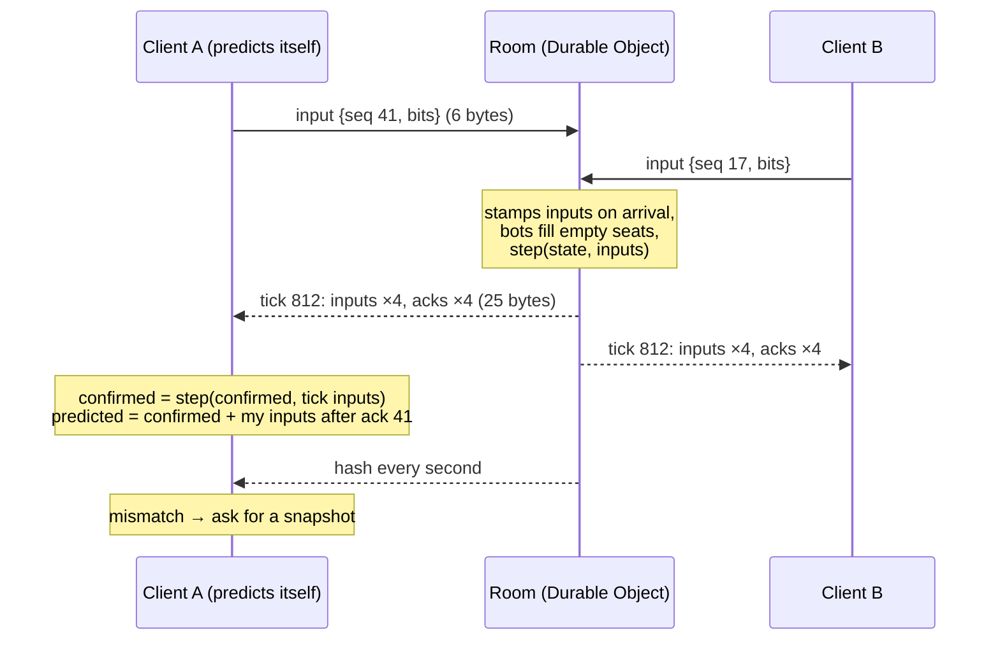

# Force Push

> *Your bomb is a `git push --force`.* A free 3D browser game for 2 to 4 players: walk an open-plan office, drop force-pushes, and paint the floor in your branch's colour. Whoever owns the most of the codebase when the sprint ends wins. The result is a diff.

**Status:** playable: offline against bots, online rooms through a Cloudflare Durable Object, three maps plus a daily one, replays and the end-of-match highlight. Launching at https://force-push.vinicius-albuquerque.com.br (see `ROADMAP.md` for what's left).

Player-facing text is English by default, with a Brazilian Portuguese toggle. Code, comments and docs are in English.

| Doc | What's in it |
|---|---|
| [`GAME_PLAN.md`](GAME_PLAN.md) | Design, the rules and their numbers, rooms, maps, look and tokens, architecture and netcode, risks |
| [`ROADMAP.md`](ROADMAP.md) | Ordered task list and current progress |
| [`CLAUDE.md`](CLAUDE.md) | Project rules (language, testing, git workflow, design sync, architecture) |
| [`TODO_FOR_YOU.md`](TODO_FOR_YOU.md) | Open decisions and things only the developer can do |
| [`FORCE_PUSH.md`](FORCE_PUSH.md) | The original one-page pitch |
| [`designs/`](designs) | Exports of the design canvas boards: screens, phone layouts, the branches, items and art direction |
| [`marketing/`](marketing) | Press kit and launch posts (drafts) |

## How it plays

1. Open a link or type a room code (`FRI-1758`). Four seats, four branches: `main`, `feature`, `hotfix`, `dev`. Empty seats are bots.
2. Drop a force-push. Three seconds later it blasts in a cross and paints every tile it reaches in your colour.
3. Blasts break legacy boxes (some hide coffee, a rubber duck, Stack Overflow, a second monitor or a rebase) and stop at server racks.
4. Caught in a blast, you're reverted: 4 seconds out and 3 tiles lost. Nobody is eliminated.
5. In the last 30 seconds the code freeze closes the edge of the map.
6. When the sprint ends, the tiles are counted: *"main won: +212 −181 (31%)"*. Rematch, watch the biggest push again, or copy a replay link.

Keys: **WASD** or arrows to walk, **Space** to drop a push, **Esc** for the menu. On phones: a stick on the left, **push -f** on the right.

## The interesting problem

A match is a pure function of a seed, a map and everyone's inputs: `step(state, inputs) → state`, 20 times a second, in integers only. The same code runs in the browser and on the server.

- **Server authority, client prediction.** Clients send five bits per tick. The server runs `step` and broadcasts each tick's inputs; each client runs ahead with its own inputs and rolls back when the server's arrive. A property test drives random inputs through random latency and checks that every client converges to the server.
- **Bots on the same `step`.** Bots read a danger map of pending blasts and only drop a push they can escape. 1,000 seeded bot matches run in CI.
- **Territory, not kills.** `+` counts tiles you painted, `−` tiles you lost, and `+ − −` is what you own: an invariant checked on every tick.
- **3D from code.** Every model is a bevelled box built at load and drawn with three.js.

## How it's built

```
src/core      pure simulation: map, movement, blasts, reverts, scoring, bots, room, codec, replays
src/content   data: rules' numbers, maps (JSON), power-ups, branches, bot weights, both locales
src/net       client side of the protocol: prediction and rollback, the WebSocket session
src/ui        three.js arena, DOM HUD and screens, input, the app loop
server        Cloudflare Worker + one Durable Object per room (imports src/core)
tests         Vitest + fast-check (mirrors src), server tests, Playwright e2e
tools         size budget, colour-blind check, bot stats, model preview
```

### Determinism

`src/core` has no `Math.random`, no clock, no floats in the state, no DOM and no network; an ESLint rule enforces it. State is integers and typed arrays, so it clones cheaply, hashes the same everywhere (FNV-1a over every field) and travels as a snapshot. Tests hold it to that: `step` twice on the same inputs gives the same state, a recorded run hashes to a pinned value, and Playwright replays a recorded 3-minute match in Chromium, Firefox and WebKit and compares each browser's final hash with Node's.

### Netcode



- The server is the authority. It stamps each input to the tick it arrives on (no inputs "from the future"), runs `step` 20 times a second and broadcasts every tick's inputs with the last input it had from each player.
- Each client keeps a **confirmed** state, the server's ticks applied in order, so it always equals the server's state for that tick. Its **predicted** state is the confirmed one re-run with its own inputs the server hasn't acknowledged yet, rebuilt every tick. A wrong guess is corrected as soon as the server's inputs arrive. Your own player is drawn from the prediction; everyone else from the confirmed state, interpolated.
- A property test (`tests/net/client.test.ts`) runs random inputs through random per-link latency and jitter and checks that every client ends each tick in the server's state once the inputs arrive. Playwright plays a whole sprint with two browsers through `wrangler dev` and checks both end on the same hash.
- `?lag=150&jitter=40` simulates a bad network in the browser.

### Bots

Bots (`src/core/bot.ts`) read only the state and return the same five bits a player sends, so they run identically on the server, offline and in a replay; randomness comes from a hash of seed, tick and seat. Each decision builds a danger map (when every tile will be inside a blast, chains included), flees if standing in one, otherwise scores reachable tiles (boxes and other branches' tiles a push would paint, power-ups, rivals in the cross) and only drops a push when a safe tile is reachable before it goes off. CI runs 1,000 seeded bot-only matches and fails on a stuck bot or a walk into a visible blast; the daily map is only accepted after bots play it.

### The diff

`+` counts tiles that turned to your colour and `−` tiles of yours that turned to anything else, so `+` minus `−` is exactly what you own. A fast-check property checks it, tile conservation and "nobody inside a rack, a box or someone else's push" after every tick of random matches.

### Replaying a bug

A match is `seed + map + version + inputs`. Copy the replay link from the result (or build one in a test with `encodeReplay`), open it with `?replay=…` to watch it, or load it in a test with `decodeReplay` and `replayState(replay, tick)` to get the exact state at any tick. Bug fixes start with a failing test built that way.

## Requirements

- **Node.js 22 LTS** and npm
- **Git LFS** (the design JPGs are stored in LFS)
- For online rooms locally: nothing extra (`npm run server` runs Wrangler, installed as a dev dependency)

## Commands

| Command | What it does |
|---|---|
| `npm run dev` | Dev server (forwards `/api` to `npm run server`) |
| `npm run server` | Builds and runs the Worker and rooms locally with Wrangler on :8787 |
| `npm run check` | Lint, typecheck, unit tests, build and the bundle-size budget (run before every commit) |
| `npm run e2e` | Playwright in Chromium, Firefox, WebKit and a phone |
| `npm run colours` | The colour-blind check of the floor colours |
| `npm run bots [n] [s]` | n bot-only matches of s seconds, with stats |
| `npm run test:bots` | The 1,000 seeded bot matches (CI) |
| `npm run deploy` | Build and deploy to Cloudflare (needs Wrangler credentials) |

## Contributing workflow

1. Pick the next task in `ROADMAP.md`.
2. Write the feature together with its tests, keeping logic in `src/core/`.
3. If it changes something a design board shows, update the board (see `CLAUDE.md`).
4. Run `npm run check` and make sure it passes.
5. Commit. Before every push, run the `security-audit` skill on the changes (see `CLAUDE.md`).

## License

MIT (see `LICENSE`). Fonts: Space Grotesk and JetBrains Mono, both under the SIL Open Font License, self-hosted.
